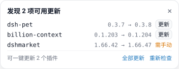

# dsh-update-check

Startup update check for DeepSeek Harness: one check per launch, one card, one click per update.

[](LICENSE)
[](https://github.com/deepseek-ai/deepseek-harness)
[](https://github.com/topics/dsh-plugin)

English | [中文](README.zh.md)



A profile is a list of package versions, and those versions move on without you: a plugin ships a fix, a market releases a patch, the app publishes a new nightly. The running app says nothing about any of it.

This plugin fills that gap. Once per launch it compares what you are running against what is published, and when something is behind it puts one card in the corner of the window — a row per outdated package, a button per update, and nothing at all when everything is current.

It reads versions and asks before installing. It never upgrades on its own, never touches a package you did not click, and serves nothing but version numbers over its route.

## What it checks

| Target | Current version read from | Newer version read from |
| --- | --- | --- |
| DeepSeek Harness | `resources/app.asar/dsh/package.json` of the running build | the official `nightly.yml` feed |
| Profile plugins | `dependencies` in the running profile's `package.json` | the npm registry |
| `rea-agents` CLI | the global install under `%APPDATA%\npm\node_modules\rea-agents` | the npm registry |

Each target is checked on its own, so one unreachable registry degrades a single row to `unknown` instead of failing the whole check. npm lookups fall back from `registry.npmjs.org` to `registry.npmmirror.com`.

## What you see

A card in the bottom-right corner, only when something is behind:

- one row per outdated target — `package  1.2.3 → 1.2.4`, four rows shown, the rest collapsed into a count
- **更新** on rows that can be installed from here, **全部更新** in the footer to do them in one go
- **需手动** on rows that cannot — the app itself, the CLI, and plugin markets (see [Limits](#limits))
- **重新检查** to run the check again, **×** to dismiss. Leave it untouched and it closes itself after 15 seconds — hovering pauses that countdown, and an install in progress holds it open

Nothing renders when everything is current.

The card is offered once per application start, not once per page load. The Host hands the offer out a single time, and the first page to read it takes it — so dismissing it, switching panels or reloading the page keeps it quiet. Quit Harness and start it again to see a fresh check.

> The interface text is Chinese today. The layout and the route are language-independent.

## How it works

1. The Host half registers `GET /dsh-update-check/api/status` and starts one check when the bundle activates.
2. That check runs with six-way concurrency: one feed read, one npm read per plugin, one local version read for the CLI.
3. The Client half polls the route and renders into the `shell.overlay` slot — the frame-wide layer above every column, so the card belongs to no session and no panel.
4. **更新** posts `{ "name": "..." }` to `/dsh-update-check/api/install`. The route accepts only names the current check marked outdated and installable, so it cannot be used as a generic install proxy.
5. The install is two steps: `installBundle`, and if the manager answers `already-installed`, `removeBundle` followed by `installBundle` again. That is the same shape the app's own Plugins page uses, because this manager has no in-place update.
6. When the install settles, the check runs once more and the card reflects the new versions.

## Limits

- **Markets cannot update themselves.** Removing the bundle unloads the code that would run the reinstall (upstream issue #900), so those rows stay manual and show the command to run instead.
- **The app itself** is a desktop build behind the nightly feed; the card reports the newer version and leaves the download to you.
- **`rea-agents`** is a global npm install, not a profile dependency: `npm i -g rea-agents@latest`.
- **A version is compared, never assumed.** A target with no readable current version, or a registry that answers nothing, is reported `unknown` rather than counted as up to date.
- Replacing a plugin reloads its Host module. That is what makes an update take effect without restarting, and it also means the update offer of this plugin resets whenever it is itself reinstalled.

## Install

```bash
dsh plugin --profile <profile> add github:1731988818/dsh-update-check
```

That registers the bundle in the profile's `dsh.profile.bundles` as well, so the next launch loads it.

`pnpm` caches git dependencies by commit hash, so run the same command again after a push to pick up new code.

Inside a running session the same install is one tool call:

```
plugin_manager install_bundle github:1731988818/dsh-update-check
```

Requires DeepSeek Harness 0.2.1 or newer, on the desktop or the web app.

## Route

| Method | Path | Purpose |
| --- | --- | --- |
| `GET` | `/dsh-update-check/api/status` | Snapshot of the last check. `?refresh=1` starts a new one. |
| `POST` | `/dsh-update-check/api/install` | Body `{ "name": "package-name" }`. Accepts only a plugin the current check marked outdated and installable. |

The route returns version numbers and package names only. It reads no files from the request and installs nothing the card did not offer.

## Uninstall

```bash
dsh plugin --profile <profile> remove dsh-update-check
```

Nothing is left behind: the plugin writes no files, keeps no state between launches, and its route disappears with the bundle.

## License

[MIT](LICENSE)
